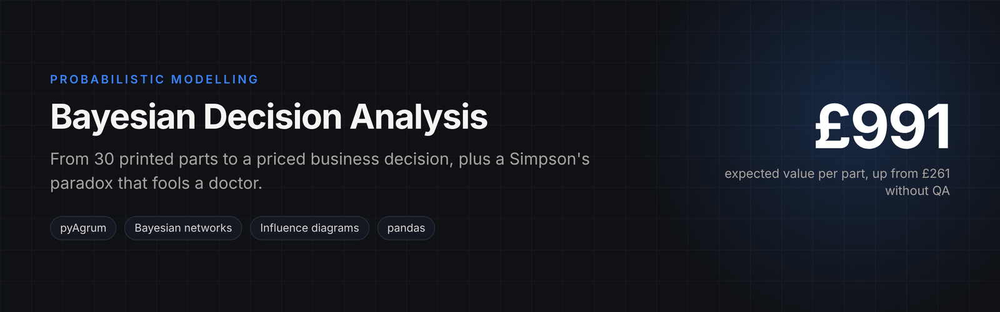
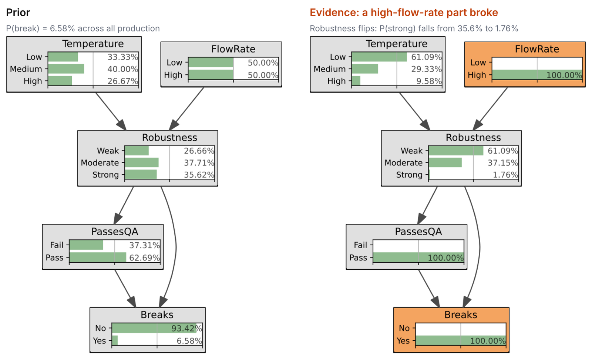
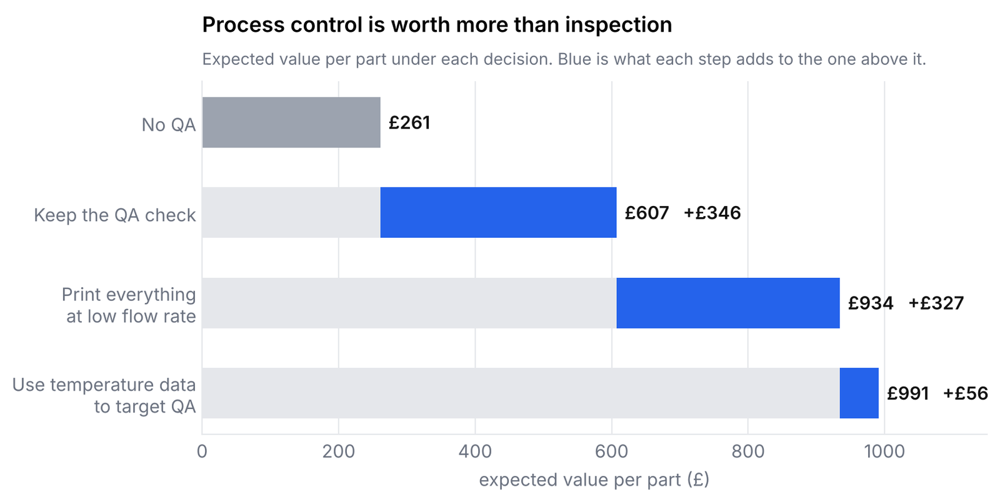
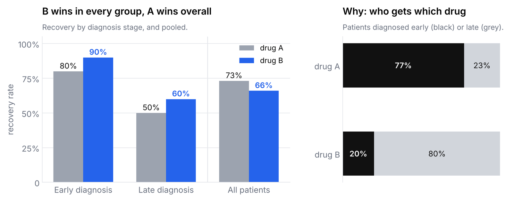

<p align="center"></p>

# Bayesian Networks and Decision Analysis for Manufacturing Quality

Probabilistic modelling of a manufacturing quality problem, from raw process data to a priced
business decision, plus a classic Simpson's-paradox case. Built with pandas, scikit-learn and
**pyAgrum**.

**Notebook:** [`bayesian_decision_analysis.ipynb`](bayesian_decision_analysis.ipynb) ·
**Data:** [`data/3d_printing.csv`](data/3d_printing.csv) (30 printed samples: temperature, flow rate, robustness)

## The scenario

A 3D-printing supplier records feedstock temperature, flow rate and the robustness of each printed
part. A customer runs a quality-assurance (QA) check that discards some parts; parts that pass may
still break in use, at a cost.

## What the notebook does

1. **Process data:** summary statistics, temperature bands (low / medium / high), and a linear
   regression of robustness on temperature band and flow rate (MSE 0.166).
2. **Bayes' rule by hand:** P(robustness), P(robustness | temperature, flow rate), P(break | passes QA)
   = 0.104, and P(weak | breaks, passes QA) = 0.613.
3. **Bayesian network** (temperature, flow rate → robustness → QA, break):
   - marginal probability that a product breaks: **6.58%**;
   - given a high-flow-rate part broke, probability it was strongly robust: **1.76%**;
   - relative risk of breaking, low vs. high temperature: **6.9×**.

   <p align="center"></p>
   <p align="center"><sub>pyAgrum's own rendering of the network. Observing a broken high-flow-rate part shifts belief to weak robustness (61%) and low temperature (61%).</sub></p>
4. **Influence diagram and decisions:**

   | Decision | Expected value per part |
   |---|---|
   | No QA | £261 |
   | Keep QA | **£607** (+£346) |
   | Supplier prints everything at low flow rate | £934 (+£327) |
   | Use temperature data to apply QA selectively | £991 (+£56) |

   <p align="center"></p>

   Fixing the process upstream is worth almost as much as the QA check itself, and once the
   process is fixed, extra information about temperature adds little. That ordering is the
   real recommendation: pay for control before paying for inspection or data.

5. **Simpson's paradox:** drug A looks better overall (26.9% vs. 34.0% risk of not recovering) only
   because it is given more often to early-diagnosed patients; within each diagnosis stage, drug B
   has the higher recovery rate.

   <p align="center"></p>

## Run it

```bash
pip install -r requirements.txt
jupyter notebook bayesian_decision_analysis.ipynb
```
